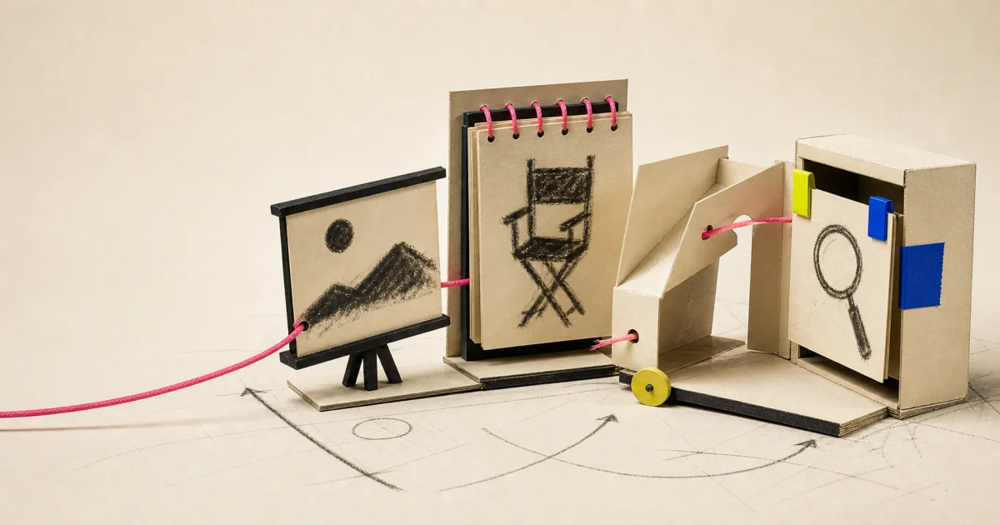
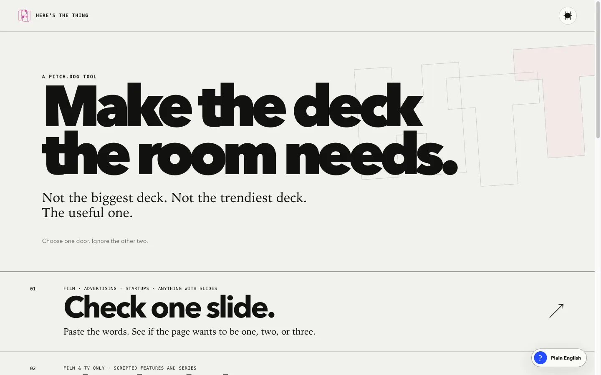
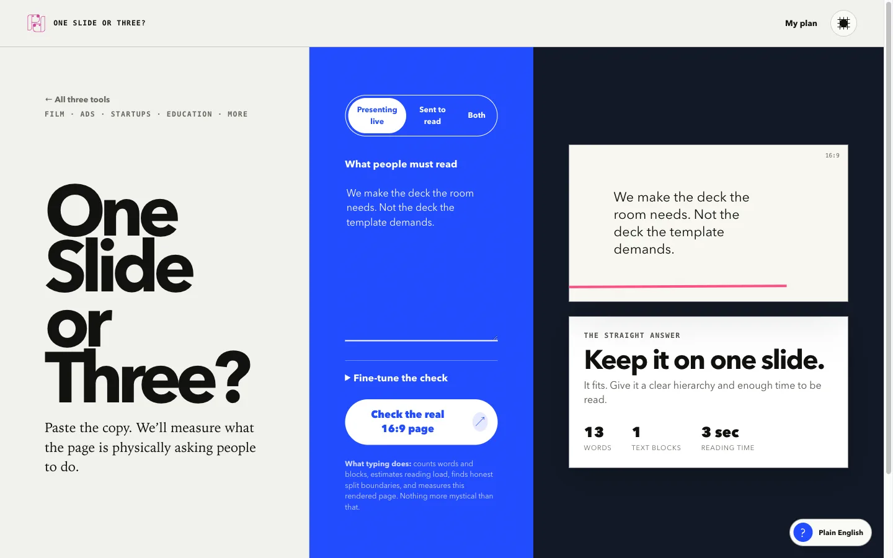
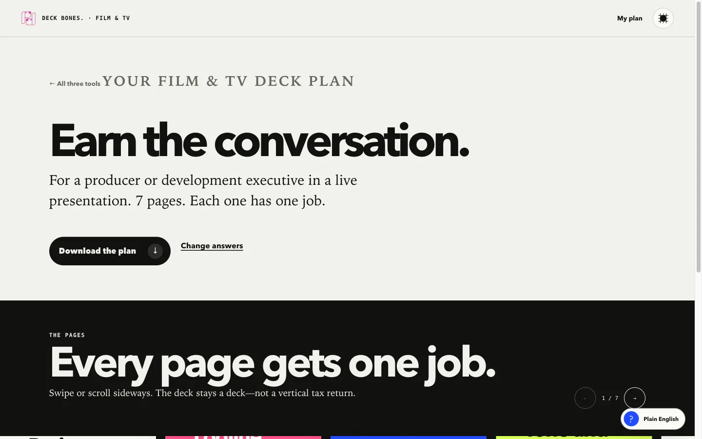
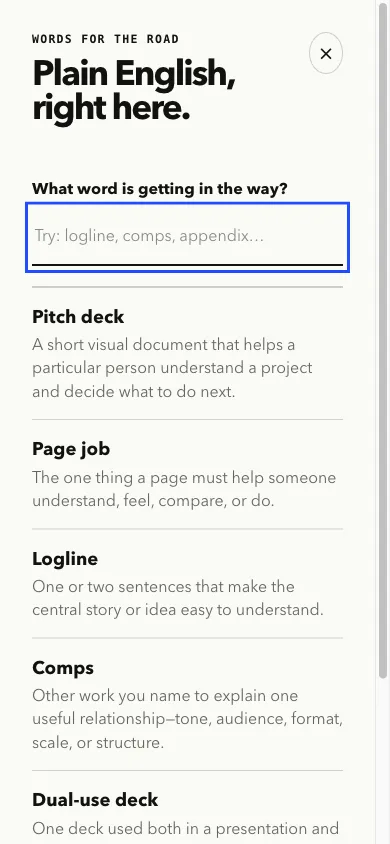

<p align="center">
  
</p>

<h1 align="center">Here’s The Thing.</h1>

<p align="center"><strong>Four focused pitch tools. Each does one useful thing and then gets out of the way.</strong></p>

<p align="center">
  <a href="https://heres-the-thing.dog-pitch.chatgpt.site"><strong>Try it live ↗</strong></a>
  &nbsp;·&nbsp;
  <a href="docs/PRODUCT.md">Meet the tools</a>
  &nbsp;·&nbsp;
  <a href="CONTRIBUTING.md">Help improve them</a>
</p>

No account. No analytics. No upload. No runtime AI bill hiding behind the curtains. Your working session stays in your browser.

Here’s The Thing is for the moment when somebody says “make a deck” and the useful question is still hiding underneath. It does not force every person through one heroic mega-wizard. It gives four related tools their own front doors, their own pace, and just enough shared memory to be helpful when you move between them.

## Pick the problem you actually have

| Tool | Best when… | What comes back |
| --- | --- | --- |
| **Slide Check** | one slide feels crowded, thin, or confused | a rendered 16:9 fit check and a plain call: keep it, split it, or rewrite it |
| **Deck Bones** | a scripted Film & TV project needs a useful deck structure | a page-by-page plan shaped by the decision, recipient, format, stage, and material you actually have |
| **Next Move** | the deck may not be the first problem | one bounded action, three things to do now, and one tempting distraction to leave alone |
| **Pitch Dictionary** | pitch language is getting in the way | 62 plain-English terms, aliases, related concepts, and context for the tool you are using |

The tools can hand useful facts to one another. They never pretend to be one thing. Lovers, not a merger.

## What it looks like

<p>
  
</p>

<table>
  <tr>
    <td width="50%"></td>
    <td width="50%"></td>
  </tr>
  <tr>
    <td align="center"><strong>Check the actual page.</strong><br>Not the worth of the idea.</td>
    <td align="center"><strong>Build the useful deck.</strong><br>Not the longest one.</td>
  </tr>
</table>

<details>
  <summary><strong>And yes, the dictionary gets its own room.</strong></summary>
  <br>
  
</details>

<a id="start-locally"></a>

## Start locally

You need Node.js 22.18 or newer.

```bash
git clone https://github.com/bomkino/heres-the-thing.git
cd heres-the-thing
npm install
npm run dev
```

Open the local address Vite prints. The website imports the deterministic engines directly from `/src`; there is no second, shadow implementation to drift out of sync.

## Prove it before changing it

```bash
npm run verify
```

That command checks:

- strict TypeScript across the engines and website;
- the domain-engine test suite;
- every one of the **12,480** configured Deck Bones quick journeys;
- all **40** broad Next Move pairs;
- the **62-term** dictionary and its cross-links;
- the browser-facing rejection list—no prose boxes in Deck Bones, no “Are you in danger?”, no engine sludge;
- the production Vite build;
- the Cloudflare Worker deep-link fallback used by Sites;
- release hygiene: no private folders, absolute workstation paths, empty Drive impostors, or common secret shapes.

See [the architecture](docs/ARCHITECTURE.md) for the boundary between evidence, product translation, and interface.

## Repository map

```text
src/                         deterministic domain engines
tests/                       engine and integration tests
website/src/                 routes, copy, interactions, WebGL, grain
website/tests/               12,480-route journey and hosting tests
website/public/              lean runtime assets
website/assets-source/       editable visual masters and provenance
docs/                        product, design, privacy, and architecture
.github/                     CI, issue forms, and contribution templates
```

## Product promises

- **One job at a time.** Complexity lives behind consent, not in the first screen.
- **Choices before blank boxes.** If the software cannot understand arbitrary prose, it has no business asking for it.
- **Film means Film & TV.** Deck Bones says exactly who it is for. The other tools remain useful across film, advertising, startups, education, and more.
- **Evidence before theatre.** Deterministic rules expose their limits. The interface translates them into human language.
- **Local first.** Session state uses browser storage. The app contains no runtime network client, authentication, analytics, database, or AI call.
- **Four sovereign tools.** Shared facts reduce repetition. They do not erase the tools’ identities.

Read the fuller [product doctrine](docs/PRODUCT.md), [design notes](docs/DESIGN.md), and [privacy model](docs/PRIVACY.md).

## Contributing

The best contribution is not “more features.” It is a clearer decision, a missing real-world route, a sharper definition, a browser bug, or a smaller piece of friction.

Start with [CONTRIBUTING.md](CONTRIBUTING.md). Product changes need a failing test or a concrete user journey. Visual changes need a reason beyond fashion. Copy changes should sound like a useful human, not a software tribunal.

## Licence and brand

- Software and authored documentation: **GNU AGPL v3 or later**. See [LICENSE](LICENSE).
- Original generated visual family and its derivatives: **CC BY-SA 4.0**. See [ASSET-LICENSE.md](ASSET-LICENSE.md).
- The `pitch.dog` name and logo remain brand identifiers, not a generic open-source badge. See [TRADEMARKS.md](TRADEMARKS.md).

Fork it. Study it. Improve it. Run your version. If you operate a modified network service, share the corresponding source as the AGPL requires. Please do not make something else and imply pitch.dog made or endorsed it.

---

Made by [pitch.dog](https://pitch.dog/) for people trying to make the deck the room actually needs.
