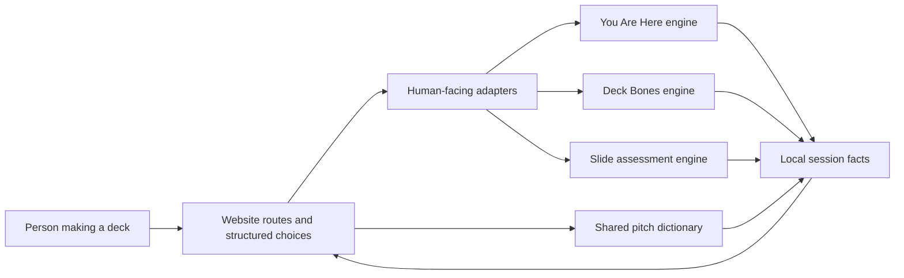

# Architecture

Here’s The Thing uses one engine layer, one translation layer, and one interface. The separation matters: evidence should not be rewritten by whatever screen happens to display it.

## Engine authority: `/src`

The root source contains deterministic domain code:

- `you-are-here/` — next-action routing and handoff gates;
- `deck-bones/` — Film & TV deck routes, page jobs, evidence, and blocks;
- `one-slide-or-three/` — copy load, delivery relation, rendered fit, and split candidates;
- `dictionary/` — terms, aliases, relationships, and tool-specific context;
- `shared/` — portable session facts and privacy-aware serialization;
- `suite.ts` and `bridges.ts` — explicit handoffs between sovereign tools.

The engines return structured evidence. They do not render HTML and do not call the network.

## Product translation: `/website/src/adapters.ts`

The original engines are richer than the first-time interface should be. Adapters translate engine results into answers a person can use without exposing route IDs, certainty labels, or internal language.

An adapter may:

- select and rename evidence for the current screen;
- order page jobs;
- explain a blocked route in plain English;
- suggest the next tool when the engine allows it.

It may not invent a fact, erase a block, or turn a candidate rule into certainty.

## Interface: `/website/src`

The site is a dependency-light Vite application written in TypeScript and DOM APIs.

- `main.ts` — route rendering, events, state, copy, dictionary overlay;
- `content.ts` — structured choices and their human explanations;
- `measure.ts` — real 16:9 browser measurement;
- `atmosphere.ts` — route-aware WebGL with a static fallback;
- `grain.ts` — animated film grain with visibility and reduced-motion handling;
- `styles.css` — theme, responsive layout, motion, and accessibility states.

## Hosting boundary

Vite writes static files to `website/dist/client`. `website/worker/index.js` becomes `dist/server/index.js` and does two things:

1. asks the Sites asset binding for the requested file;
2. falls back to `index.html` only for missing browser document requests, so `/deck` and `/words` work on a cold visit.

Missing images and scripts stay honest 404s. The worker adds a small set of security headers and has no data store or external fetch target.

## State and privacy

- Theme preference: `localStorage`.
- Current answers: `sessionStorage`.
- Copy-to-clipboard: only after a user action.
- Network persistence: none.
- Accounts, cookies, analytics, database, runtime AI: none.

See [PRIVACY.md](PRIVACY.md).

## Verification layers

1. strict TypeScript;
2. focused engine tests;
3. cross-tool session tests;
4. exhaustive quick-journey enumeration;
5. visible-copy rejection guards;
6. production build;
7. Worker deep-link and 404 tests;
8. release hygiene scan.

Tests do not prove editorial truth or universal fit. They prove that the declared rules are deterministic, wired, and not quietly bypassed.
